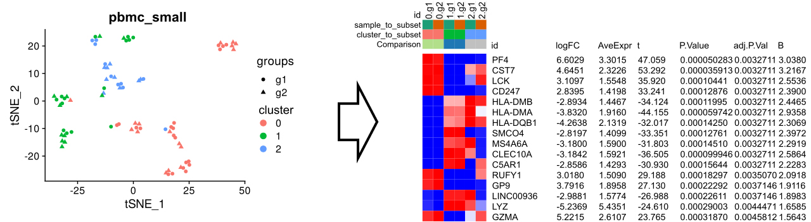

# Seurat2Phantasus

Seurat2Phantasus aggregates gene expression values from a Seurat object by
biological sample and cell cluster to generate pseudobulk profiles. Results
can be returned as a Bioconductor `ExpressionSet` or exported as a GCT 1.3 file
for analysis in [Phantasus](https://artyomovlab.wustl.edu/phantasus/).

Maintained by [Park Laboratory](https://github.com/ParkLaboratory).
Package author and maintainer: **Sangbum Park** ([spark@msu.edu](mailto:spark@msu.edu)).
For questions and maintenance requests, please use this repository's
[Issues](https://github.com/ParkLaboratory/Seurat2Phantasus/issues).
The package source and documentation were restored from the historical `v0.1`
tag; the original commit history has been preserved.
The current package version is **0.1.0**; `v0.1` above identifies the historical
restoration source, not the current release.

## Workflow overview



The original illustration uses the small `pbmc_small` example: cells on the
left are grouped by sample and cluster, their expression values are summed
to form pseudobulk profiles, and the resulting GCT file can be explored in
Phantasus (right). The figure illustrates the workflow; it is not a validation
of biological replication or statistical significance.

## Installation

```r
install.packages(c("SeuratObject", "remotes", "BiocManager"))
BiocManager::install(c("Biobase", "phantasusLite"), ask = FALSE, update = FALSE)
remotes::install_github("ParkLaboratory/Seurat2Phantasus")
```

Use a mutually compatible R/Bioconductor release. The package accepts
SeuratObject v4 and v5 objects. For v5, select an exact layer name; to aggregate
across split layers, join the intended layers first. See
[Seurat's layer documentation](https://satijalab.org/seurat/articles/seurat5_essential_commands.html).
GCT input/output uses `phantasusLite`; the full Phantasus web application is
not required for installation.
Automated checks are defined in `.github/workflows/r-tests.yaml`. A workflow
definition alone does not establish that a particular package version passed;
check the associated run in the repository's Actions tab.

## Reproducible example

This synthetic example demonstrates file conversion only, not a biological
experiment or a valid differential-expression study.

```r
library(SeuratObject)
library(Seurat2Phantasus)

counts <- matrix(
  c(1, 0, 2, 3, 1, 0, 0, 4, 2, 2, 1, 1),
  nrow = 3,
  dimnames = list(paste0("gene", 1:3), paste0("cell", 1:4))
)
metadata <- data.frame(
  sample = c("sample1", "sample1", "sample2", "sample2"),
  cell_type = c("T", "T", "T", "B"),
  row.names = colnames(counts)
)
obj <- CreateSeuratObject(counts = counts, meta.data = metadata)

es <- Seurat2Phantasus_expressionset(
  seuratobject = obj,
  assay = "RNA",
  layer = "counts",
  sample_to_subset = "sample",
  cluster_to_subset = "cell_type"
)
Biobase::exprs(es)
Biobase::pData(es)

Seurat2Phantasus_gct(
  seuratobject = obj,
  assay = "RNA",
  layer = "counts",
  sample_to_subset = "sample",
  cluster_to_subset = "cell_type",
  output_gct_file = "pseudobulk.gct"
)
```

Upload the resulting GCT file to Phantasus. See the
[Phantasus manual](https://ctlab.github.io/phantasus-doc/quick-start.html)
for available downstream analyses.

## Input and output conventions

- Sample identifiers should represent biological replicates, not individual
  cells. Sample and cluster annotations must be non-empty and non-missing
  for every cell in the selected layer.
- Use raw `RNA` counts for count-based downstream methods. Other layers are
  summed as supplied; normalized, log-transformed, integrated, or SCT values
  are not automatically converted back into raw counts.
- Layer names are matched exactly. A layer named `counts.raw` is valid and
  does not prevent selecting an existing `counts` layer. If only split layers
  such as `counts.sample1` and `counts.sample2` exist, join the intended layers
  first (for example, `obj <- SeuratObject::JoinLayers(obj, assay = "RNA")`)
  to aggregate across them. Select a particular split layer explicitly only
  when its subset of cells is intended.
- Gene IDs and sample/cluster annotations must not contain tabs or line breaks,
  which are delimiters in the GCT format.
- In-memory dense and sparse matrices are supported. Disk-backed matrices
  are not currently supported.
- Rows are genes; columns are observed sample/cluster pairs. Unobserved
  pairs are not filled with artificial zero-count samples.
- Columns follow the first appearance of each pair in the selected layer.
  Names use `cluster.sample`, made unique if necessary. Always use
  `Biobase::pData(es)` to identify groups rather than parsing column names.
- Output annotations are a unique `id`, `sample_to_subset`, `cluster_to_subset`, and
  `n_cells`; feature annotations include `gene_id` for GCT export.
  The legacy `slot = "counts"` argument remains supported;
  use `layer` for new code.
- Cell-level sparse matrices remain sparse during aggregation. The final
  pseudobulk matrix is dense, so memory still scales with genes times groups.

## Optional batch adjustment

Batch adjustment is not required for file conversion. Choose an analysis
strategy appropriate to the experimental design. Do not treat cell clusters
from the same donor as independent biological replicates.

If using `sva::ComBat_seq()`, supply raw RNA counts and match sample metadata
by name. Do not assign a fixed batch vector based on an assumed column order.
The following template assumes a user-provided `sample_info` data frame with
one row per biological sample and columns `sample`, `batch`, and `condition`:

```r
# Install separately if needed: BiocManager::install("sva")
stopifnot(!anyDuplicated(sample_info$sample))
index <- match(Biobase::pData(es)$sample_to_subset, sample_info$sample)
stopifnot(!anyNA(index))
Biobase::pData(es)$batch <- sample_info$batch[index]
Biobase::pData(es)$condition <- sample_info$condition[index]
stopifnot(!anyNA(Biobase::pData(es)$batch),
          !anyNA(Biobase::pData(es)$condition))

# Analyze one cell type at a time using real biological replication.
cell_type <- "T" # Replace with the intended cell type.
selected <- Biobase::pData(es)$cluster_to_subset == cell_type
stopifnot(any(selected))
es_type <- es[, selected]
adjusted <- sva::ComBat_seq(
  counts = Biobase::exprs(es_type),
  batch = Biobase::pData(es_type)$batch,
  group = Biobase::pData(es_type)$condition
)
adjusted_es <- Biobase::ExpressionSet(
  assayData = adjusted,
  phenoData = methods::new("AnnotatedDataFrame", Biobase::pData(es_type)),
  featureData = Biobase::featureData(es_type)
)
phantasusLite::writeGct(adjusted_es, "pseudobulk_adjusted.gct", gzip = FALSE)
```

This template is not intended for the tiny synthetic example above. Check
replication within batches and whether batch is confounded with condition.
See the [sva manual](https://bioconductor.org/packages/release/bioc/manuals/sva/man/sva.pdf)
for model assumptions and requirements.

## Development checks

After installing this package and its dependencies, run:

```r
source("tests/regression.R")
```

Checks compare aggregation with hand-calculated results, exercise sparse
and single-cell groups, validate input errors, and test GCT write/read round
trips. SeuratObject v5 checks cover split layers, exact layer names, and assay
cell subsets. CI additionally runs `R CMD check` through
`r-lib/actions/check-r-package`. Errors fail CI; warnings remain visible in the
check report while the historical license declaration awaits institutional review.
These checks do not validate a real biological analysis or every supported
R/Seurat combination. Review workflow results before using an updated version
for research.

## License status

The historical package contains an unfinished license declaration. This update
does not grant a new license or determine copyright ownership. The rights holder should
confirm the intended license before redistribution under a stated license.
